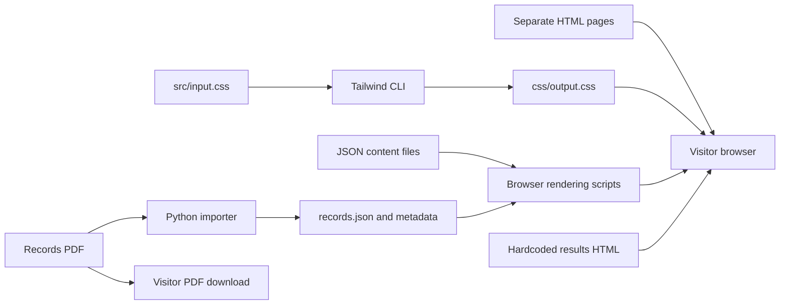

# Kettle Run Swimming — project review and change-planning brief

**Follow-up direction:** [Working project brief](/Users/daltonregenbogen/kettle-run-swimming/PROJECT_BRIEF.md) records the owner's learning goals, technology preferences, and content-editing requirements expressed after this audit. This review remains the original baseline.

**Reviewed:** October 18, 2026  
**Scope:** the current local working directory, including uncommitted edits and homepage experiments.  
**Status:** analysis and proposals for review. No application code, content data, dependencies, or deployment settings were changed.

## 1. Overall assessment

This project has a useful foundation for a public swim-team information site. Its strongest parts are the roster archive, readable records presentation, structured practice schedule, school identity, and real team photography. The main weaknesses are incomplete visitor journeys, inconsistent information, duplicated page structure, and an update process that requires editing several independent sources.

The site is currently a collection of hand-maintained static pages with some JavaScript-driven data views. Several pages are functional, several are placeholders, and three different homepage designs coexist. A significant redesign is reasonable, but the first decisions should be about the site's purpose, content ownership, season handling, and page structure. Those decisions determine how much rebuilding is worthwhile.

**My recommended direction:** preserve the team identity, historical data, and useful page behaviors; consolidate content and shared layouts; repair the records publishing process; then redesign the site around the tasks athletes, parents, and prospective swimmers need to complete. A static site can still meet the requirements visible in this repository.

### Most consequential findings

| Priority | Finding | Practical effect |
| --- | --- | --- |
| High | The downloadable records PDF differs from the website's JSON in five girls' events. | Visitors get different records depending on which format they use. Running the PDF importer would replace the newer JSON values with the older PDF values and remove record badges. |
| High | The homepage's tryout and announcements links point to missing files. | Two prominent paths end in missing pages. |
| High | Desktop dropdowns depend on mouse hover; the closed mobile drawer remains in keyboard tab order. | Keyboard users cannot reliably navigate the same site as mouse users. |
| High | Announcements and “This Week at KR” contain unfinished or placeholder material. | The homepage looks more operational than its information actually is. |
| High | Meet information is maintained separately in schedule JSON, results HTML, important dates, and homepage text. | Dates, times, cancellation status, and results can disagree. Some already do. |
| Medium | The homepage loads 11 large JPEGs totaling 31.85 MB in the local browser check. | Photography dominates page weight, including on mobile. |
| Medium | About 23 KB of header markup is repeated across nine primary pages. | Navigation, accessibility, and visual changes must be repeated manually and can drift. |
| Medium | npm reports six affected development dependency packages: five high and one moderate. | The build toolchain needs a reviewed dependency refresh; this finding alone does not establish a public-site exploit. |
| Planning decision | The site labels 2025–2026 as the active season. | As of this review date, decide whether the next version is an archive, an offseason site, or a 2026–2027 site before replacing dates. |

“High” and “Medium” here describe project priorities. npm severity labels are reported separately from that prioritization.

## 2. What was reviewed and verified

The review covered all 56 project files outside `.git` and installed `node_modules`: every HTML page, the authored and generated stylesheets, all nine browser scripts, both maintenance scripts, all eight content JSON files, both SVGs, all 12 photos, the records PDF, package files, domain file, README, and ignore rules. Installed dependencies were inventoried and checked with npm's advisory service; their full third-party source was not manually audited.

Verification included:

- Parsing every HTML file for structure, headings, local references, duplicate IDs, images, scripts, metadata, and placeholder links.
- Loading the nine primary pages plus both new homepage experiments in headless Chrome at 1440 px and 390 px widths.
- Checking the current homepage and roster at 320, 360, 768, 820, 1024, and 1280 px widths as well.
- Reviewing desktop and mobile screenshots of the homepage, roster, and records.
- Exercising roster seasons and filters, desktop dropdown activation, mobile menu state and keyboard focus, and carousel reduced-motion behavior.
- Blocking roster and competition-schedule JSON requests in the browser to inspect failure states.
- Parsing all content JSON and checking practice dates against their stored weekday labels.
- Running the existing Tailwind CLI with its output directed to `/tmp`, leaving `css/output.css` untouched.
- Extracting the records PDF using the existing parser function, without executing its file-writing entry point, and comparing that result with the current JSON.
- Running `npm ls --depth=0` and a read-only `npm audit --json`.

### Boundaries and uncertainties

This is a review of the local project, not a claim that these exact files are deployed. The repository contains a custom-domain file, but live hosting settings, DNS, HTTPS, caching headers, deployment permissions, and production logs were not inspected. Google Drive document permissions and the correctness of official meet results were not independently verified. The browser review used Chrome; Safari, Firefox, physical devices, and a screen reader were not tested. No Lighthouse score, field performance measurement, or full WCAG conformance claim is being made.

### Existing work preserved

At the beginning of the review, these tracked files already had local modifications: `.DS_Store`, `css/output.css`, `index.html`, and `src/input.css`. `index-alt.html` and `index-merged.html` were untracked. Those files were inspected as part of the current state and left as found. This review document is the only project file added by the review.

## 3. Architecture and how the site works

### Current stack

| Layer | Current implementation |
| --- | --- |
| Pages | Separate HTML documents in the repository root; no shared page templates. |
| Styling | Tailwind CSS 4.1.18, custom theme tokens and marquee CSS in `src/input.css`, generated `css/output.css`. |
| Browser behavior | Plain JavaScript for navigation, carousel, marquee, and data rendering. Practice rendering uses an ES module; other renderers are classic scripts. |
| Content | A mix of hardcoded HTML, eight JSON files, one local PDF, and external Google Drive documents. |
| Build | npm commands compile CSS only. They do not assemble pages, validate content, process images, or create a clean publishing directory. |
| Server-side functionality | No application server, API, database, authentication, submission handler, or CMS is present in the project. |
| Hosting signal | `CNAME` contains `kettlerunswim.org`; package metadata identifies a GitHub repository. GitHub Pages is plausible, but not confirmed from these files. |

The PDF-to-JSON arrow is currently hazardous because the PDF and JSON have diverged. Results also bypass the structured-content approach used elsewhere, which explains much of the information duplication.

### Development commands

| Command | Actual behavior |
| --- | --- |
| `npm run dev` | Watches and recompiles CSS. It does **not** serve HTML or provide a complete local preview. |
| `npm run build` | Compiles and minifies CSS in place. It does **not** build a complete deployable site artifact. |
| `npm run records:meta` | Rewrites records metadata using today's date. It does **not** update or verify records or their PDF. |
| `python3 scripts/update-records.py` | Parses the PDF and overwrites records JSON and metadata. `pdfplumber` is required but is not declared in a Python dependency file. |

The isolated CSS build succeeded. Existing `css/output.css` is 64,244 bytes; a fresh minified build during review was 50,141 bytes. These are different generated outputs, not proof of semantic equivalence. The current stylesheet also contains stale utility rules from editing iterations. CSS size is a minor concern compared with photo size.

## 4. Page-by-page assessment

### `index.html` — current homepage

**Current state:** 1,109 lines. The recent local design uses Barlow Condensed throughout, a split photo-and-introduction hero, green/orange school colors, cream content background, announcement rows, a weekly card, a contact card, and JSON-driven important dates.

**Keep:** the recognizable team identity, welcoming program description, authentic photography, clear coach contact, and connection to schedules/results.

**Problems and decisions:**

- `tryouts.html` and `announcements.html` do not exist, although the homepage links to them.
- All three announcement rows link to `#`; there is no announcement article data or archive behind them.
- The practice line literally says “Mon / Wed / Fri — Time — Location”; the next-meet line is also a template. The practice page describes Monday–Thursday practice, so even the placeholder cadence disagrees.
- “Latest Results” is explanatory text rather than a working result link.
- The handbook link reaches a resources placeholder rather than an actual handbook.
- The contact description includes editing guidance: “Keep one clear contact point.” Replace it with visitor-facing copy.
- Important dates load from JSON, but old dates are always shown, with no past/upcoming distinction or offseason state.
- At 390 px, the long introduction and photo appear before practical information. Decide how much space the homepage should devote to recruitment versus current-team logistics.
- Mobile hero links measured only about 20–22 px tall at narrow widths; they need a more usable touch area.
- All 11 hero slides start with `opacity-0`. If the carousel script does not execute, there is no visible initial photo.
- Headings jump from `h2` to `h4`, then `h3`, then `h5`. These peer sections should have a coherent hierarchy.
- Homepage typography, top-band wording, footer color, and spacing differ from interior pages.

**Proposed disposition:** redesign after deciding the homepage's primary job; populate it from the same approved content sources used by the detailed pages.

### `competition-schedule.html` — meets

**Current state:** 834 lines; renders 10 meets from JSON. Includes opponent and venue keys and a horizontally scrollable table.

**Keep:** the structured meet data, concise table, explicit abbreviations, and responsive table wrapper.

**Improve:**

- The data contains start times, hosts, and regular/postseason designations, but the renderer omits them. Meet time is one of the most useful details for visitors.
- There is no structured cancellation/postponement status. The January 30 district meet appears as a regular schedule entry although results mark it canceled.
- The PDF download has an empty `href`; no schedule PDF exists locally.
- Only the mobile “last updated” element is populated; the desktop element remains blank.
- On a failed JSON request, the page stays at “Loading…” and logs an error only to the console.
- Opponent expansion text is hover-only; full names should be accessible through touch and keyboard interaction too.
- Abbreviation keys are duplicated in the source, including a second Millbrook entry incorrectly labeled `MHS` instead of `MBHS`.

**Proposed disposition:** retain the page, make practical event information complete, and share meet IDs/content with results.

### `practice-schedule.html` — practices

**Current state:** 618 lines plus the renderer; displays 15 weeks and 60 dated practice entries from JSON. The rendered table has 90 body rows because each week adds two header rows.

**Keep:** the full-season view, day/date pairing, exceptions/notes, explicit off-day styling, and visible fetch-error treatment.

**Improve:**

- Both “last updated” placeholders remain empty even though the JSON includes an update date.
- The PDF download has an empty `href`; no practice PDF exists locally.
- The renderer hardcodes the season and normal practice description rather than deriving that information from configuration.
- Off days retain ordinary practice times and sometimes a “Normal” note. Strikethrough helps visually, but the text should clearly say canceled/no practice.
- Weekly notes and a computed date range are not used in the rendered output.
- Weekly column labels use `td` elements in the body and the table has an empty `thead`; the structure needs clearer table-header associations.
- An in-season view should make the current or next week easy to find. Archived seasons should remain explicitly labeled and navigable.

**Proposed disposition:** retain the structured schedule; improve current-week discovery, semantics, and archive handling.

### `roster.html` — current and previous rosters

**Current state:** 759 lines. Two available seasons; alphabetical sorting and All/Boys/Girls filters. Current season has 29 athletes: 11 boys and 18 girls. The previous season has 30: 17 boys and 13 girls.

**Keep:** season history, simple team filtering, initials avatars, alphabetical order, and safe DOM construction using `textContent`.

**Confirmed problems:**

- Mobile and desktop season selectors are independent. Selecting 2024–2025 on mobile changes the table to 30 athletes but leaves the desktop selector set to 2025–2026. Resizing can therefore expose a misleading selected value.
- Initialization loads the default roster twice because both selector setup blocks call `loadSeason`.
- Season-change promises have no local error handling, and rapid requests can resolve out of order.
- Fetch failure leaves an empty-looking table with no visitor-facing explanation.
- The PDF download has an empty `href`; no roster PDF exists locally.
- Code looks for last-updated elements that do not exist in the HTML.
- Grade labels include both `8th` and `8th.` in the older data. Roles often contain an empty string instead of an empty list. Middle names are stored but not displayed.

The team filters worked correctly in the browser: Boys 11, Girls 18, All 29.

**Proposed disposition:** preserve and refine. Establish one season state for every viewport, clarify public roster fields, and decide whether search is actually useful for a roster this size.

### `team-records.html` — all-time records

**Current state:** 720 lines; renders 11 boys' and 11 girls' records, supports record badges, shows update metadata, and provides a working local PDF link. The mobile presentation is one of the stronger existing layouts.

**Keep:** all-time records, boys/girls grouping, compact mobile rows, source download, and recognition badges once their meaning is documented.

**Improve:**

- Resolve the PDF/JSON discrepancy described in section 5 before relying on the maintenance scripts.
- Define badge meaning explicitly: for example, whether “VHSL Class 3” denotes a classification record, a meet record, or another distinction. The data alone does not establish that meaning.
- Remove unused sort/filter variables or implement an agreed need; their presence currently suggests functionality that does not exist.
- Extract repeated boys/girls row construction into a common renderer/template when the page is refactored.
- Retain real header relationships when adapting tables for mobile/screen readers.

**Proposed disposition:** keep the page and much of its presentation; repair its publishing workflow first.

### `2025-2026-results.html` — season results

**Current state:** 2,234 lines and 91.9 KB. Results, summary statistics, meet details, postseason placings, and Google Drive PDF links are manually embedded in HTML. JavaScript collapses extra score rows behind “+ more.”

**Keep:** individual dual scores, season summaries, postseason achievements, and full meet-result documents. The listed regular-season scores sum to the displayed 8–10 boys and 15–3 girls records; the shown 44% and 83% are consistent after rounding.

**Improve:**

- Summary says “Completed Meets through 2/7/2026” while including state placements for February 19.
- The summary shows boys 15th and girls 3rd at states; the state meet card still says `TBD` for both.
- January 9, 2026 is labeled Saturday; the calendar date is Friday.
- Several start times differ from the schedule JSON. Examples: December 20 and January 3 are 7 PM here versus 6 PM in JSON; January 9 is 8 PM here versus 7 PM in JSON; regionals are 2:15 PM here versus 2 PM in JSON. These require source confirmation rather than an assumed correction.
- Results mark districts canceled for weather; schedule JSON does not record that cancellation.
- “Results Archive” has an empty `href` and a download attribute rather than a working archive destination.
- Collapsed score content relies on CSS geometry/opacity. Review hidden-state semantics and reduced-motion support when retaining this interaction.
- Eight full-results links depend on external Drive sharing. Ownership, public access, and long-term archival strategy remain to be confirmed.

**Proposed disposition:** rebuild the implementation around structured meet/results data while preserving the historical scores, documents, and existing public URL or a redirect.

### `about.html`, `resources.html`, and `news.html` — unfinished pages

| File | Current state | Proposed decision |
| --- | --- | --- |
| `about.html` | 547 lines, almost all shared chrome; title says About, visible heading says Contact, body contains one generic sentence. | Either create a useful program/staff/contact page or merge it into an agreed destination. |
| `resources.html` | 545 lines; visible heading is “More,” followed by a coming-soon sentence. | Build a real forms/handbook/standards resource hub or temporarily remove its misleading entry points. |
| `news.html` | 542 lines; empty main content and no `h1`. Homepage points to nonexistent `announcements.html` instead. | Choose one news/announcements route and implement a manageable publishing model. |

These pages exist but are not complete features. Their names, navigation labels, headings, and intended content need to be reconciled.

### Homepage experiments and scratch material

| File | What it contributes | Issues / disposition |
| --- | --- | --- |
| `index-old.html` | Earlier homepage; participation-form links and practical shortcuts; working 11-slide carousel. | Broken `results.html` link, placeholder tryout destination, older embedded dates. Preserve useful content before archiving. |
| `index-alt.html` | Standalone design experiment: compact header, Barlow body font plus condensed headings, different content treatment. | Mostly inline CSS; mobile hamburger has no implemented menu behavior; missing tryout/announcement routes and different hardcoded season dates. Use as a visual reference. |
| `index-merged.html` | A second standalone experiment combining a larger header, ticker, carousel, mobile drawer, and cream content section. | Missing `kr-logo-dark.svg`, hardcoded content/dates, separate navigation/carousel implementation, incomplete accessibility. Use as a visual reference, not an automatically deployable replacement. |
| `random.html` | Seven important-date list fragments. | Not a complete HTML document; overlaps the JSON-rendered important-date feature. Candidate for removal after checking for any unique copy. |

The old homepage contains four participation-document links absent from the current homepage: physical, concussion history, acknowledgement, and athlete/parent contact form. Preserve those destinations for content review before deleting the old file. Their current validity and intended public access were not verified.

## 5. Data, accuracy, and publishing workflow

### Current content inventory

| File | Contents | Observations |
| --- | --- | --- |
| `assets/data/importantDates.json` | 7 dates, October 2025–January 2026; season label and title. | No update field, status, links, expiry, or distinction between archived and upcoming dates. |
| `assets/data/meet-schedule.json` | 10 meets, December 2025–February 2026; updated February 11, 2026. | Season is `2026`, whereas other files use `2025-2026`. Times include both padded and unpadded hour strings. Several useful fields are not displayed. |
| `assets/data/practice-schedule.json` | 15 weeks, 60 entries: 49 normal and 11 off; updated February 23, 2026. | Stored weekday labels match the dates. Season ends February 19 in the entries; last two off days still have normal-looking notes/times. |
| `assets/data/records.json` | 22 records; 11 per gender; two nonempty badges. | Newer values than the PDF for five girls' events. PascalCase fields differ from other content schemas. |
| `assets/data/records-meta.json` | Update date, PDF cache version, source path. | Uses a different date format than the Node metadata generator. Metadata can change independently of actual records. |
| `assets/rosters/roster-index.json` | Two season filenames, newest first. | The first entry implicitly determines the default; there is no explicit active-season configuration. |
| `assets/rosters/roster-2025-2026.json` | 29 athletes; updated February 11, 2026. | Structured and reusable; needs field conventions. |
| `assets/rosters/roster-2024-2025.json` | 30 athletes; updated February 19, 2025. | Useful history; minor grade-label inconsistency. |

All eight content JSON files parsed successfully. No duplicate IDs were found by the static HTML scan. There is no automated schema validation enforcing required fields, valid statuses, unique records, or season consistency.

### Records: confirmed PDF-versus-website differences

The existing parser successfully extracted 22 PDF records. Five girls' record times differ from the website data:

| Event | Website JSON | Downloadable PDF |
| --- | --- | --- |
| 50 Free | 24.19, February 7, 2026 | 24.34, February 15, 2019 |
| 100 Free | 51.74, February 7, 2026 | 52.75, February 12, 2022 |
| 200 Free | 1:46.71, February 19, 2026 | 1:48.88, March 4, 2025 |
| 100 Back | 54.70, February 7, 2026 | 56.19, December 30, 2024 |
| 100 Fly | 53.17, February 19, 2026 | 53.66, March 4, 2025 |

The first two also have different record holders. This comparison establishes disagreement within the project; official records still need confirmation from the chosen authority.

The Python importer checks only the total count, despite its comment suggesting an 11-per-gender check. It does not validate uniqueness or preserve `RecordBadge`. It writes records first and metadata second, so the two files are not published atomically. The Node metadata script uses ISO dates and drops `sourcePdf`, while Python uses US-style dates and includes that field. Both create day-based versions, so multiple PDF updates on one day can share a cache key.

**Recommended decision:** choose one canonical records source. A strong default for this project is reviewed structured records data with the PDF generated from that same data. If an official PDF must remain authoritative, import to a reviewable intermediate result, validate all event/gender pairs, preserve supplemental metadata, and review differences before replacing the website data. Do not treat the current importer as a safe synchronization step.

### Proposed content model

The redesign should define these concepts before picking a tool:

| Concept | Minimum useful information |
| --- | --- |
| Site/program | Name, school, colors, contact, navigation, current season, season status. |
| Season | Stable ID, display label, start/end dates, active/archived status, linked roster and meets. |
| Venue | Stable ID, full name, short name, address/map destination, relevant arrival notes. |
| Opponent | Stable ID, school name, abbreviation. |
| Meet | Stable ID, season, date/time/timezone, venue, host, format, opponents, status, bus/warmup notes, results links. |
| Results | Meet ID, boys/girls dual scores or championship placements, source document, update timestamp. |
| Practice | Date, start/end time, venue, status, applicable group, notes; grouped into weeks for display. |
| Announcement | Title, publication date, body, category, optional expiry, pinned status, destination. |
| Resource | Title, category, destination, season/version applicability, owner/update date. |
| Record | Event ID, group, course, time, date, holder(s), optional distinction, source. |

This is a proposed logical model, not a requirement to introduce a database. JSON and/or Markdown can represent it. The important change is that the homepage, schedules, archives, and downloads should derive repeated facts from the same reviewed information.

## 6. JavaScript and maintenance scripts

| File | Responsibility | Assessment and future treatment |
| --- | --- | --- |
| `js/mobileMenu.js` | Drawer animation, body scroll lock, accordion submenus, Escape handling. | Useful baseline, but missing trigger naming/state, hidden-content focus control, focus movement/return, and desktop dropdown behavior. Also lacks resize reconciliation when crossing to desktop with the menu open. Replace/refactor as one navigation component. |
| `js/heroCarousel.js` | Builds dots, changes slides every 5.5 seconds, previous/next, hover/focus pause. | Works, but ignores reduced motion, lacks a persistent pause control and announced active-slide state. Manual activation restarts the timer even while interaction may still be focused. Simplify or replace after the hero decision. |
| `js/marquee.js` | Duplicates text to fill the scrolling lane; reacts to font loading, resize, reduced motion. | More careful motion handling than the carousel. The current announcement strip is hidden, so decide whether the feature is needed at all. The implementation retains only the first original item, unsuitable for a multi-message feed without changes. |
| `js/renderImportantDates.js` | Fetches, sorts, escapes, and displays important dates and labels. | Good starting point with a visible error fallback. Needs validation, explicit season/date relevance, empty state, and a decision about truncating event names. |
| `js/renderCompetitionSchedule.js` | Fetches meet JSON and builds table rows/tooltips. | Omits important data and has weak failure handling. Some fields are inserted into HTML without escaping, unlike opponent names. Use consistent safe rendering when refactoring. |
| `js/renderPracticeSchedule.js` | Module that builds weekly schedule HTML. | Escapes text, checks HTTP status, shows errors. Hardcoded season copy and incomplete semantic/update integration should be removed. |
| `js/renderRoster.js` | Fetches season index/roster, sorts, filters, builds rows. | Safe text rendering and useful features. Consolidate season state, avoid duplicate loads, catch selection errors, and prevent stale requests overwriting newer selections. |
| `js/renderRecords.js` | Fetches and displays records with badges. | Safe escaping and visible errors. Repeated gender-specific rendering and unused state should be simplified. |
| `js/records-meta.js` | Fetches record update metadata and cache-busts the PDF link. | Works on the custom-domain root. Leading `/assets/...` paths reduce portability to a subdirectory deployment. Tie metadata to the actual published record/PDF content. |
| `scripts/update-records.py` | PDF extraction, records and metadata writes. | Parsing works for the supplied file. Workflow can overwrite newer records and discard badges; dependency and validation are incomplete. Redesign before use. |
| `scripts/update-records-meta.mjs` | Date-based metadata update. | Overlaps Python with a different schema/date convention. Consolidate into the selected records publishing workflow. |

There are also inline scripts in the results page and both new homepage experiments. They create additional implementations of behavior that should be shared if retained.

Some renderer functions occupy the global scope with repeated names such as `formatDate` and `escapeHtml`. The current page-specific combinations mostly avoid collisions, but reusing them together will be fragile. Shared utilities/modules or build-time rendering would make the boundaries clearer.

## 7. Design system and visitor experience

### What is worth preserving

The green `#005130`, orange `#F37322`, black header, team photography, bold athletic headings, and records/roster cards create a coherent starting identity. The interior pages' data presentation is generally more mature than the homepage's information workflow.

### What needs a single decision

| Area | Current inconsistency | Proposed default for discussion |
| --- | --- | --- |
| Typography | Current home uses condensed type for everything; interior pages use system sans; experiments pair Barlow with condensed headings. | Condensed display headings with a more readable body/data font. Review actual samples before selecting. |
| Content width | Several relative maximum widths and different experimental layouts. | One reading width and one wider data-page width. |
| Surfaces | Gray and cream backgrounds, white/black footers, several card/border treatments. | A small agreed palette and consistent page shell. |
| Navigation | Split desktop nav, hover dropdowns, separate mobile variants, several dead entries. | One shared navigation model exposing only working destinations. |
| Buttons | Mixed radii, padding, sizes, focus treatment; very short mobile hero CTAs. | Consistent primary/secondary/link styles with clear focus and practical hit areas. |
| Page names | About/Contact, Resources/More, News/Announcements do not agree. | Labels that match visitor tasks and page headings. |
| Time-sensitive content | Fixed dates, generic “current season” labels, no offseason state. | Explicit active season and clear upcoming/complete/archived states. |

There are also invalid or undefined utilities: `bg-grey-100`, concatenated `bg-grey-100md:bg-white`, and `bg-background-50` without a corresponding theme color. `top-[--header-h]` produces an invalid CSS value for the menu shell, while the panel uses the valid `top-(--header-h)` form. In the browser, the closed mobile menu shell had zero height and the panel started at a hardcoded 110 px, although interior headers measured 114 px on mobile. Fix the underlying layout relationship when rebuilding navigation.

### Recommended information structure

A working proposal is: **Home · Schedule · Results · Team · Join · Resources**, with Contact in an obvious shared location. Exact labels and whether Practice/Meets need a shared schedule page are review decisions.

- **Home:** concise program identity, current season status, relevant alerts, next practical event, latest genuine update, and a clear path for new swimmers.
- **Schedule:** meets and practices, with date/time/location/status prominent and an archive selector if retained.
- **Results:** a current-season overview and past seasons linked from real archive navigation.
- **Team:** roster, staff/contact, and program information; records can remain a prominent separate destination or sit here.
- **Join:** tryout/participation requirements, required forms, timing, and coach contact.
- **Resources:** handbook, standards, forms, venue information, and other approved documents.

This structure should shrink if the team cannot maintain all those areas. For example, a simple Join section can precede a full tryout page, and announcements can be omitted until there is a reliable publishing habit.

## 8. Accessibility and responsive behavior

### Confirmed findings

| Finding | Evidence / consequence |
| --- | --- |
| Desktop dropdowns cannot be activated reliably from the keyboard. | Focusing and clicking a top-level button without pointer hover left `aria-expanded="false"` and the submenu hidden. Only `group-hover:block` drives visibility. |
| Mobile menu trigger has no accessible name or expanded state. | The button contains only SVGs and has no `aria-label`, `aria-expanded`, or control relationship. |
| Closed mobile drawer stays in tab order. | Keyboard traversal moved through all 14 drawer buttons/links, including collapsed submenu links, while the drawer had `aria-hidden="true"`. |
| Focus is not restored on close. | A focused drawer link remained the active element after closing. There is no focus containment or background inertness while open. |
| Carousel does not respect reduced motion. | With reduced motion enabled, the active slide changed from index 0 to 1 during a 5.9-second observation. |
| Carousel controls need clearer semantics. | Dots have labels but no active-state announcement; arrow buttons rely on arrow text; no persistent pause/resume control exists. |
| Main homepage actions are too short on mobile. | At tested narrow widths, hero action heights were about 20–22 px. |
| Some focus visibility is removed. | Hero action links use `focus:outline-none` without a replacement focus treatment. |
| Content/table structure needs cleanup. | Homepage heading levels skip; news has no main heading; practice column labels are ordinary data cells. |
| Images have generic repeated alternatives. | All homepage photos use “KR Swim”; decide which are decorative and which need meaningful descriptions. |

The tested pages did not show whole-document horizontal overflow at 390 or 1440 px. The current home and roster also passed that narrow overflow check at the additional widths listed earlier. This does not establish that all elements are comfortably spaced, that every table is fully usable, or that zoom/text resizing works.

For the navigation rebuild, use a disclosure pattern for ordinary website links; if the mobile drawer is intended to behave as a modal, implement the corresponding focus and background-interaction behavior. W3C documents both [disclosure navigation](https://www.w3.org/WAI/ARIA/apg/patterns/disclosure/examples/disclosure-navigation/) and [modal dialog behavior](https://www.w3.org/WAI/ARIA/apg/patterns/dialog-modal/). Its [carousel guidance](https://www.w3.org/WAI/tutorials/carousels/) also covers user control over motion and keyboard operation.

Contrast ratios, screen-reader output, zoom, long names, and real touch interaction still need targeted verification during implementation.

## 9. Assets and performance

### Photography inventory

Sizes below use decimal MB. The 12 originals total **33.27 MB**, about 97% of the project bytes outside Git and installed dependencies.

| File | Dimensions | Size |
| --- | --- | --- |
| `IMG_2327.jpeg` | 4032 × 3024 | 2.90 MB |
| `IMG_2335.jpeg` | 4032 × 3024 | 2.86 MB |
| `IMG_2347.jpeg` | 4032 × 3024 | 2.70 MB |
| `IMG_2359.jpeg` | 4032 × 3024 | 2.33 MB |
| `IMG_2596.jpeg` | 4032 × 3024 | 3.29 MB |
| `IMG_3978.jpeg` | 4032 × 3024 | 3.31 MB |
| `IMG_6483.jpeg` | 2804 × 2895 | 2.32 MB |
| `IMG_6976.jpeg` | 4032 × 3024 | 3.53 MB |
| `IMG_6984.jpeg` | 4032 × 3024 | 2.22 MB |
| `IMG_7014.jpeg` | 4032 × 3024 | 1.42 MB |
| `IMG_7034.jpeg` | 4032 × 3024 | 3.23 MB |
| `IMG_7037.jpeg` | 4032 × 3024 | 3.15 MB |

The current homepage references every photo except `IMG_7014.jpeg`. Its 11 overlaid carousel images all loaded in the browser check despite `loading="lazy"`, totaling **31,851,466 image resource bytes**. This is a local resource-size observation, not a throttled-network load-time measurement.

**Proposed improvements:** choose a smaller, intentional hero set; create appropriately sized WebP/AVIF or optimized JPEG derivatives; provide responsive image candidates; load the initial visible image promptly; and defer later slides explicitly. Preserve original photographs separately from deployed derivatives. The first visible image should not be lazily delayed; Chrome's [LCP guidance](https://developer.chrome.com/docs/lighthouse/performance/lighthouse-largest-contentful-paint) explains the loading-priority issue. HTML supports responsive image candidates through [`srcset` and `sizes`](https://developer.mozilla.org/en-US/docs/Web/HTML/Reference/Elements/img).

### Other assets

- `assets/kr-logo.svg`: 146 KB, 217 SVG elements, used throughout the primary site. Optimize only after checking visual equivalence; it is an existing vector asset.
- `assets/kr-logo-v3.svg`: 296 KB, 277 elements, not referenced by the reviewed HTML/JS/CSS. Keep as a design option until the brand decision is made.
- `assets/records/krhs-records.pdf`: approximately 34 KB; works as a download but contains the older values described above.
- Both `.DS_Store` files are tracked operating-system metadata. They are cleanup candidates and should be ignored going forward.
- The shared stylesheet imports all weights and italic variants of Barlow Condensed, although the homepage's actual typography uses a smaller subset. Choose the font system first, then request only the needed styles and consider direct font loading/preconnect or self-hosting.

No image-processing pipeline or font strategy is currently documented. Optimization should prioritize photos over small reductions to CSS or browser scripts.

## 10. Dependencies, security, and repository hygiene

### Dependency baseline

`package-lock.json` records 72 dependency packages, including platform-specific optional packages. There are four direct development dependencies and no declared production npm dependencies:

| Direct package | Locked version | Role |
| --- | --- | --- |
| `@tailwindcss/cli` | 4.1.18 | CSS compiler command. |
| `tailwindcss` | 4.1.18 | Utility CSS framework. |
| `autoprefixer` | 10.4.23 | Declared, but no separate configured use was found. |
| `postcss` | 8.5.6 | Direct declaration plus use in the dependency tree. No standalone PostCSS configuration was found. |

The live npm audit on the review date reported these affected package groups:

| Package | npm severity | Dependency type |
| --- | --- | --- |
| `baseline-browser-mapping` | Moderate | Transitive development dependency. |
| `browserslist` | High | Transitive development dependency. |
| `nanoid` | High | Transitive development dependency. |
| `picomatch` | High | Transitive development dependency. |
| `postcss` | High | Direct development dependency. |
| `source-map-js` | High | Transitive development dependency. |

npm reported fixes available for all six package groups. These tools are part of the build/development environment; the primary HTML pages do not ship them as runtime browser libraries. Review the dependency paths and applicable advisories before selecting updates or removing unused direct packages. For example, the PostCSS maintainers describe the source-map input conditions for one finding in their [security advisory](https://github.com/postcss/postcss/security/advisories/GHSA-6g55-p6wh-862q). No dependency was updated and no audit fix was run.

### Application hardening and maintainability

- There is no login, writable backend, or user submission endpoint in this codebase. No secret/environment configuration files were found among project files.
- Several renderers escape text or use `textContent`, which is good. Competition rows interpolate some unescaped fields into `innerHTML`; harden that path before introducing less-trusted content sources. The current source is repository-controlled JSON, so this is not evidence of an existing remote-input exploit.
- No automated checks, CI workflow, deployment workflow, lint configuration, data schemas, or test scripts are present.
- There is no Node version declaration and no declared Python dependency environment.
- The README contains only the project name. It does not explain local preview, data updates, records imports, CSS generation, deployment, or season rollover.
- `package.json` has default-looking metadata, including a nonexistent `index.js` entry point. Align metadata with a static-site project if package metadata is retained.
- The root folder mixes deployable pages, experiments, raw assets, scripts, source files, and documentation. A clean publish directory would make accidental publication of scratch pages less likely.

## 11. Search, sharing, and deployment readiness

The primary pages have page-specific titles, viewport tags, and English language declarations. They do not define meta descriptions, canonical URLs, social sharing metadata, or favicon links. There is no sitemap, robots file, custom 404 page, or structured site metadata in the repository.

These gaps are secondary to functional/content repairs, but the redesign should include:

- Unique page descriptions and a consistent site title format.
- An approved sharing image and favicon using the existing brand assets.
- Explicit handling of season archives and duplicate homepage experiments.
- Stable routes or redirects for renamed pages and existing season result links.
- A real 404 page with paths back to schedules, contact, and the homepage.
- A documented publishing target, build command, published directory, domain setup, and rollback procedure.

Browser-fetched schedules and rosters are absent from the original HTML response, although Chrome displays them after scripts run. Build-time rendering would improve resilience for visitors and tools that do not execute that JavaScript. It would also let filters enhance content already present on the page.

Actual production cache behavior, headers, domain ownership, TLS, and search indexing remain unverified. The repository alone cannot establish them.

## 12. Keep / improve / rebuild / remove proposal

These are recommendations for review, not approved deletions or implementation instructions.

| Treatment | Items | Reason |
| --- | --- | --- |
| Keep | School colors and identity; approved team photography; historical roster/record/result information; direct coach contact. | These give the site its identity and lasting value. |
| Keep and improve | Roster filtering and season archive; mobile records presentation; JSON practice schedule; meet keys; useful legacy form links. | Existing work can carry forward with focused improvements. |
| Rebuild shared foundation | Header/navigation, mobile drawer, footer, page shell, content conventions, season configuration. | These changes affect nearly every page and prevent repeated work. |
| Rebuild data workflow | Results storage, shared meet information, records/PDF generation, announcements if retained. | Current independent sources already disagree. |
| Redesign | Homepage hierarchy and hero, interior-page typography, forms/resources experience. | Practical use and visual consistency need an agreed direction. |
| Archive after extracting value | `index-old.html`, `index-alt.html`, `index-merged.html`. | Preserve ideas/history while establishing one production homepage. Git history or a clearly excluded design folder can hold them. |
| Remove after confirmation | `random.html`, tracked `.DS_Store` files, stale utility/source fragments, unused state/comments. | Reduce clutter after checking unique content and references. |
| Decide before removal | Empty About/News/Resources pages, marquee feature, unused logo/photo, standalone PostCSS/Autoprefixer declarations. | Whether they are unnecessary depends on the selected scope and build system. |
| Hide or complete before release | Empty downloads, Staff, Past Seasons, handbook, standards, top-ten links. | Every visible control should lead to real content or have an honest unavailable state. |

## 13. Architecture options for the next version

| Option | Benefits | Tradeoffs | Fit |
| --- | --- | --- | --- |
| Retain handwritten HTML and repair it | Lowest initial migration effort; familiar files and hosting. | Shared changes still repeat unless a build/template layer is added; content drift remains easy. | Suitable for a tightly limited cleanup with few future pages. |
| Add static generation and shared templates | Reusable navigation/page layouts; build-time data rendering; keeps a static hosting model. | Introduces a page build and some migration work. | Best fit for the significant changes discussed so far. |
| Add an editorial CMS over a static site | Can make updates easier for nontechnical coaches or staff. | Requires ownership, access management, preview/review decisions, and ongoing tool maintenance. | Choose only if someone needs a non-code publishing interface. |
| Build a full application with a backend | Supports private accounts, live submissions, custom administration, or dynamic workflows. | More infrastructure, security, maintenance, and deployment complexity. | No current requirement in this repository establishes the need. |

**Provisional recommendation:** a shared-template static site, retaining Tailwind if it matches the preferred development workflow, with structured season/meet/results data and small browser enhancements. Eleventy is a plausible incremental fit for the existing HTML/data approach; Astro is also a plausible fit if component-based page composition is preferred. Both support generating static pages, as described in the [Eleventy documentation](https://www.11ty.dev/docs/) and [Astro rendering documentation](https://docs.astro.build/en/guides/on-demand-rendering/). The recommendation is based on this project's content and maintenance needs, not a requirement to adopt either tool.

Do not migrate merely to obtain a different syntax. The useful outcomes are one shared layout, one set of repeated facts, better editorial control, and reliable publishing. Tool selection should follow the decisions below.

Tailwind scans source text for utility tokens, including source files beyond HTML. Archived experiments and review examples can therefore influence output unless source scope is controlled. Its [source detection documentation](https://tailwindcss.com/docs/detecting-classes-in-source-files) explains the model; use an explicit production source boundary in the future build.

## 14. Proposed sequence and acceptance criteria

### Phase 0 — agree on the brief

**Work:** settle audience priorities, page inventory, current season/status, design reference, content owner, records authority, and scope of public information. Inventory external documents and recover useful legacy form links.

**Deliverable:** approved sitemap, page content checklist, design direction, data ownership rules, and a prioritized backlog. No implementation should be inferred from this document alone.

### Phase 1 — establish the foundation

**Work:** select the smallest suitable page-build approach; create shared layout/navigation/footer; standardize typography, buttons, spacing, and season settings; separate production output from experiments; review dependency updates; document local preview and publishing.

**Acceptance:** a navigation change comes from one source; every published nav destination is valid; drawer and desktop dropdowns work with keyboard/touch; closed content cannot receive focus; layout works at the agreed breakpoints; existing URLs have a preservation/redirect plan.

### Phase 2 — make information consistent

**Work:** validate content schemas; reconcile meet times/statuses and result summaries; unify meet/results identifiers; repair the records source/PDF process; synchronize roster controls; implement clear loading/error/empty states; decide download versus print views.

**Acceptance:** homepage, schedule, and results agree on meet facts; both roster controls reflect the same season; summaries derive from reviewed results; all 22 record entries match the approved source and download; a failed request produces a useful message.

### Phase 3 — complete visitor journeys and redesign pages

**Work:** implement the agreed homepage; create genuine Join/Resources/Staff/Announcements content where selected; remove placeholder copy; optimize photos; improve table and mobile presentation; connect contact and participation paths.

**Acceptance:** a new swimmer can find requirements and forms; a parent can find the next event's date/time/location/status; current athletes can reach the relevant practice information; archives are labeled; visible actions have real outcomes; motion and focus behavior follow the agreed accessibility approach.

### Phase 4 — verify and prepare release

**Work:** run a clean build, local-link and data checks, records reconciliation, focused interaction checks, representative desktop/mobile visual review, targeted accessibility review, and agreed performance measurements. Add metadata, 404 behavior, deployment documentation, and a season rollover checklist. Archive/remove selected scratch material only after content preservation.

**Acceptance:** no unintended missing local resources or placeholder destinations; no unresolved primary interaction failures; browser-console errors understood; performance meets an agreed budget; publishing and rollback are documented. Production release remains a separate action after review of the concrete result.

### Relative effort guide

| Workstream | Relative scope | Main dependency |
| --- | --- | --- |
| Fix individual dead links and placeholder copy | Small once destinations/copy are supplied | Content decisions. |
| Optimize existing photo delivery | Small–medium | Hero/photo selection and build approach. |
| Shared layouts and accessible navigation | Medium | Architecture and visual direction. |
| Roster/state/error improvements | Small–medium | Data/rendering approach. |
| Unified meets/results and season archives | Medium–large | Verified historical data and archive scope. |
| Canonical records and synchronized PDF publishing | Medium | Approved source and PDF requirements. |
| Full content completion across Join/Resources/Staff/News | Variable | Availability of approved copy and an editor. |
| CMS or private team workflows | Separate scope | A demonstrated editorial/private-access requirement. |

These are relative scope comparisons, not time estimates. The content and tooling decisions could substantially change effort.

## 15. Review worksheet — decisions to settle before coding

The suggested defaults below are starting points for discussion. None has been selected on your behalf.

| Decision | Suggested starting point | Your direction |
| --- | --- | --- |
| Who should the homepage serve first? | Current athletes/parents, with a strong secondary path for prospective swimmers. | Pending |
| What season/status should launch? | Explicitly choose 2026–2027, offseason, or historical archive; retain 2025–2026 history. | Pending |
| Which visual reference is closest? | Compare the current home's identity with the experiments' heading/body typography and content treatments. | Pending |
| How much should change visually? | Agree on representative home and data-page designs before applying them everywhere. | Pending |
| Which pages are genuinely needed? | Choose the smallest useful sitemap from Home, Schedule, Results, Team, Join, Records, Resources, News. | Pending |
| Who updates the site, and how often? | Identify one owner; keep file-based content if they are comfortable with it. | Pending |
| Is an editorial interface required? | Add a CMS only if a nontechnical editor needs it. | Pending |
| What is authoritative for records? | One reviewed dataset and synchronized PDF, or a controlled official-PDF import. | Pending |
| Are all advertised PDFs needed? | Use working downloads, useful print views, or remove the controls; avoid empty links. | Pending |
| How far should archives go? | Preserve the two roster seasons and current results; define whether older results will be added. | Pending |
| Should the hero rotate automatically? | Prefer a strong static image or user-controlled gallery unless rotation serves a clear purpose. | Pending |
| Are regular announcements sustainable? | Show a feed only if someone will publish meaningful updates; otherwise prioritize stable information. | Pending |
| Which public roster fields are useful? | Retain the current useful fields; decide middle names/roles and archive policy explicitly. | Pending |
| What belongs in Resources/Join? | Recover existing form links, then approve handbook, standards, and participation instructions. | Pending |
| What hosting arrangement should remain? | Confirm the existing host/domain and preserve working URLs where practical. | Pending |
| What is the first release scope? | Foundation, correct core information, and complete primary journeys; defer optional features. | Pending |

### Suggested order for our review conversation

1. Decide the site's primary audience, season, and essential visitor tasks.
2. Choose the page inventory and visual direction using the existing homepage alternatives as references.
3. Decide content ownership and the records/meet/results source of truth.
4. Select the implementation approach that best supports those choices.
5. Turn the selected items into a concrete, sequenced implementation brief before changing application code.

## Appendix A — source locations for key findings

These links open the current local source at representative locations. Browser-only findings were also exercised as described in section 2.

| Finding | Source |
| --- | --- |
| Missing tryout destination and minimal mobile hero buttons | [index.html, line 613](/Users/daltonregenbogen/kettle-run-swimming/index.html:613) |
| Missing announcements destination | [index.html, line 861](/Users/daltonregenbogen/kettle-run-swimming/index.html:861) |
| Placeholder weekly information | [index.html, line 972](/Users/daltonregenbogen/kettle-run-swimming/index.html:972) |
| Hover-dependent desktop dropdown | [index.html, line 68](/Users/daltonregenbogen/kettle-run-swimming/index.html:68) |
| Mobile menu button and hidden drawer | [index.html, line 317](/Users/daltonregenbogen/kettle-run-swimming/index.html:317) |
| Menu state/focus implementation | [mobileMenu.js, line 17](/Users/daltonregenbogen/kettle-run-swimming/js/mobileMenu.js:17) |
| Independent roster season handlers | [renderRoster.js, line 116](/Users/daltonregenbogen/kettle-run-swimming/js/renderRoster.js:116) |
| Automatic carousel timing | [heroCarousel.js, line 45](/Users/daltonregenbogen/kettle-run-swimming/js/heroCarousel.js:45) |
| Practice schedule hardcoded copy and update placeholder | [renderPracticeSchedule.js, line 100](/Users/daltonregenbogen/kettle-run-swimming/js/renderPracticeSchedule.js:100) |
| Competition schedule rendering and error behavior | [renderCompetitionSchedule.js](/Users/daltonregenbogen/kettle-run-swimming/js/renderCompetitionSchedule.js) |
| Results summary cutoff and state placings | [2025-2026-results.html, line 607](/Users/daltonregenbogen/kettle-run-swimming/2025-2026-results.html:607) |
| State meet still marked TBD | [2025-2026-results.html, line 2103](/Users/daltonregenbogen/kettle-run-swimming/2025-2026-results.html:2103) |
| PDF importer count check and overwriting behavior | [update-records.py, line 78](/Users/daltonregenbogen/kettle-run-swimming/scripts/update-records.py:78) |
| Competing metadata writer | [update-records-meta.mjs](/Users/daltonregenbogen/kettle-run-swimming/scripts/update-records-meta.mjs) |
| Records data and downloadable source | [records.json](/Users/daltonregenbogen/kettle-run-swimming/assets/data/records.json), [records PDF](/Users/daltonregenbogen/kettle-run-swimming/assets/records/krhs-records.pdf) |
| Build and dependency declarations | [package.json](/Users/daltonregenbogen/kettle-run-swimming/package.json) |

## Appendix B — remaining project files

| File | Assessment |
| --- | --- |
| `src/input.css` | Small authored stylesheet: Google Fonts import, Tailwind import, green/orange/font tokens, marquee animation/utilities. Preserve as source if Tailwind remains; expand into a deliberate token system after design approval. |
| `css/output.css` | Generated stylesheet, currently tracked and locally modified. Treat it as build output; choose whether future publishing commits output or generates it in deployment. |
| `package.json` | CSS build/watch commands and metadata updater. Needs complete preview/build/check workflows once architecture is selected. |
| `package-lock.json` | Reproducible npm dependency baseline; retain lockfile discipline through a reviewed toolchain update. |
| `README.md` | Project-name-only documentation; replace with setup, preview, content editing, record publishing, deployment, and rollover instructions. |
| `.gitignore` | Only ignores `node_modules`. Expand deliberately for OS metadata, generated/cache files, and excluded experiments according to the chosen workflow. |
| `CNAME` | Declares the custom domain. Preserve unless the hosting/domain decision changes; actual live configuration was not verified. |
| `.DS_Store`, `assets/.DS_Store` | Tracked OS metadata. Remove during approved cleanup and ignore afterward. |

All implementation proposals in this review remain open for your revision. The immediate next deliverable should be the agreed project brief and scope, based on this baseline.
